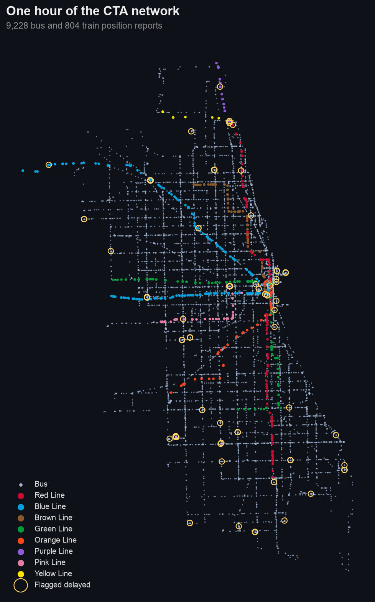
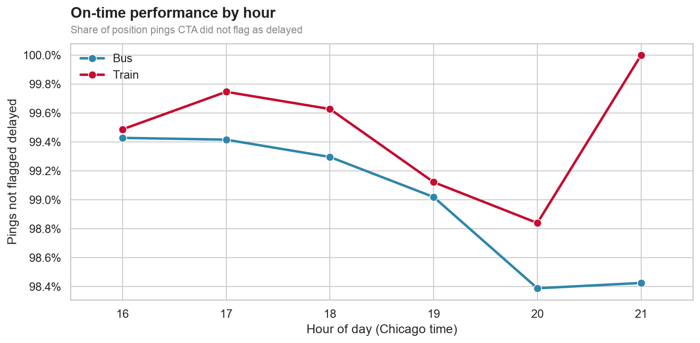
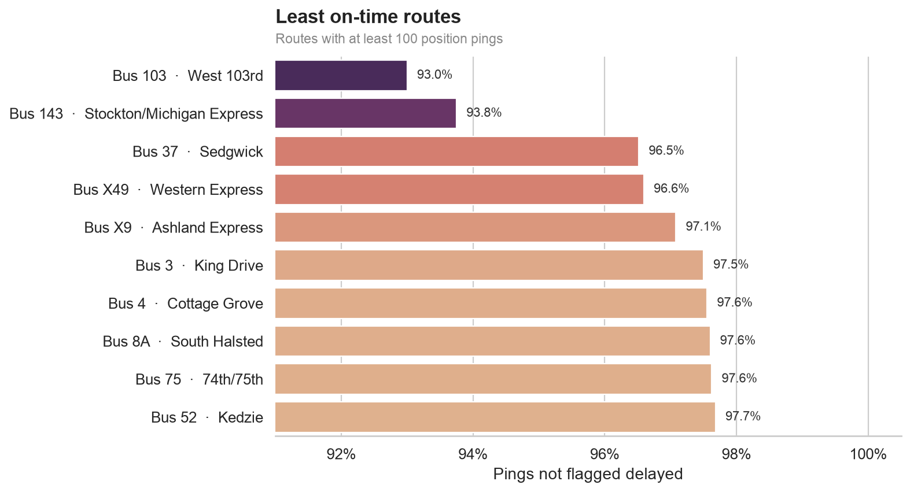
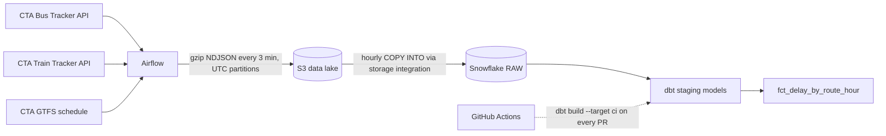

# 🚇 Chicago Transit Reliability Pipeline

[](https://github.com/UsmanAsghar23/cta-transit-pipeline/actions/workflows/dbt-ci.yml)
[](LICENSE)


An end-to-end data pipeline that measures how reliably Chicago's buses and 'L' trains run. It snapshots every CTA vehicle every 3 minutes, lands the data in an S3 lake, loads it into Snowflake, and uses dbt to build a tested, hourly on-time-performance mart by route.

---

## 🎨 Demo / Preview

**One hour of the CTA network**, drawn only from live position reports. Buses are light blue, 'L' trains are in their official line colors, and gold rings mark pings CTA flagged as delayed.



**On-time share by hour of day.** This is the share of position pings that CTA did not flag as delayed.



**Least on-time routes**, among routes with at least 100 pings.



From the first evening of collection: buses were **99.1%** on time and trains **99.3%**. The least reliable route was **Bus 103 West 103rd at 93.0%**. The charts update as more data accumulates (see [Usage](#-usage)).

### Architecture



## ✨ Features

- **Live ingestion:** Airflow polls the Bus Tracker and Train Tracker APIs every 3 minutes, collecting about 10,000 bus and 800 train position reports per hour. It writes gzipped NDJSON to S3, partitioned by UTC date and hour.
- **Idempotent warehouse loads:** an hourly `COPY INTO` reads the current and previous hour. Snowflake's load history skips files it has already loaded, so retries and backfills never create duplicate rows.
- **Tested dbt models:** incremental staging models parse and deduplicate the raw JSON, and a mart computes on-time ratio per mode, route, and Chicago-local hour. The project has 38 data tests and source freshness checks.
- **Pipeline monitoring:** a freshness DAG fails, and can alert Slack, when no new file has arrived in 15 minutes.
- **Infrastructure as code:** Terraform creates the S3 bucket, a least-privilege IAM user for Airflow, and the IAM role Snowflake assumes.
- **CI-gated merges:** GitHub Actions runs `dbt build` against a separate `CI` schema on every PR that touches dbt, and a branch ruleset blocks merging when it fails.

## 🛠️ Built With

- [Apache Airflow 3](https://airflow.apache.org/) via the [Astro CLI](https://www.astronomer.io/docs/astro/cli/overview): orchestration, running locally in Docker
- [AWS S3 and IAM](https://aws.amazon.com/s3/): the raw data lake, with encryption, blocked public access, and a 90-day lifecycle rule
- [Terraform](https://www.terraform.io/): AWS infrastructure
- [Snowflake](https://www.snowflake.com/): the warehouse, using a storage integration, an external stage, and key-pair authentication
- [dbt Core](https://www.getdbt.com/) and [dbt_utils](https://hub.getdbt.com/dbt-labs/dbt_utils/latest/): transformations, tests, and freshness checks
- [GitHub Actions](https://github.com/features/actions): CI for dbt
- [pandas](https://pandas.pydata.org/) and [seaborn](https://seaborn.pydata.org/): result charts
- [CTA Bus Tracker](https://www.transitchicago.com/developers/bustracker/), [Train Tracker](https://www.transitchicago.com/developers/traintracker/), and [GTFS](https://www.transitchicago.com/developers/gtfs/): the data sources

---

## 🚀 Getting Started

### 📋 Prerequisites

- Python 3.11 and Docker Desktop
- An AWS account, a Snowflake trial in AWS US East (Ohio) to match the bucket region, and CTA [Bus Tracker](https://www.transitchicago.com/developers/bustracker/) and [Train Tracker](https://www.transitchicago.com/developers/traintracker/) API keys

```bash
brew install hashicorp/tap/terraform awscli astro
```

### ⚙️ Installation

1. Clone the repository and install the local tools.
   ```bash
   git clone https://github.com/UsmanAsghar23/cta-transit-pipeline.git
   cd cta-transit-pipeline
   python3.11 -m venv .venv && source .venv/bin/activate
   pip install -r requirements-dev.txt -r dbt/requirements.txt
   cp .env.example .env                     # CTA keys and Snowflake settings
   python scripts/try_api.py                # smoke test: prints one bus and one train
   ```
2. **AWS (Terraform):** set a globally unique, lowercase `bucket_name`.
   ```bash
   cd terraform
   cp terraform.tfvars.example terraform.tfvars
   terraform init && terraform apply
   terraform output                                # bucket, role ARN, access key ID
   terraform output -raw airflow_secret_access_key
   ```
3. **Airflow:** fill in the API keys, the bucket, and the AWS connection, then unpause the DAGs in the UI.
   ```bash
   cd airflow
   cp .env.example .env
   astro dev start
   astro dev pytest                          # DAG integrity and unit tests
   ```
4. **Snowflake:**
   - Generate a key pair for the service user. It's gitignored and stays on your machine.
     ```bash
     cd airflow/include/keys
     openssl genrsa 2048 | openssl pkcs8 -topk8 -inform PEM -out cta_svc_key.p8 -nocrypt
     openssl rsa -in cta_svc_key.p8 -pubout -out cta_svc_key.pub
     ```
   - Run sections 1–3 of [`snowflake/setup.sql`](snowflake/setup.sql) in Snowsight as ACCOUNTADMIN.
   - Copy `STORAGE_AWS_IAM_USER_ARN` and `STORAGE_AWS_EXTERNAL_ID` from `DESC INTEGRATION` into `terraform.tfvars`, and run `terraform apply` again.
   - Run sections 4–7 of `setup.sql`.
   - Add `AIRFLOW_CONN_SNOWFLAKE_DEFAULT` to `airflow/.env` (template in `airflow/.env.example`), then run `astro dev restart`.
5. **CI:** add the repository secrets `SNOWFLAKE_ACCOUNT`, `SNOWFLAKE_USER`, and `SNOWFLAKE_PRIVATE_KEY` (the full `.p8` contents). Then create a branch ruleset on `main` that requires the `dbt-build` status check.

> 🔒 Secrets live only in gitignored `.env` files, `terraform.tfvars`, and `airflow/include/keys/`. Every committed `*.example` file contains placeholders only.

---

## 💻 Usage

**Airflow DAGs**

| DAG | Schedule | What it does |
| --- | --- | --- |
| `cta_ingest` | every 3 min | Fetches all buses and trains and writes `vehicles/source=<bus\|train>/date=YYYY-MM-DD/hour=HH/*.json.gz` |
| `cta_freshness` | every 15 min | Fails, and alerts Slack if configured, when a source's newest file is older than 15 minutes |
| `cta_load_snowflake` | hourly at :05 | `COPY INTO` the raw tables from the run's UTC hour and the previous hour |
| `cta_gtfs` | weekly | Reloads the GTFS routes, stops, trips, stop times, and calendar |

**Backfill Snowflake loads.** This is safe to repeat, because already-loaded files are skipped.

```bash
astro dev run backfill create --dag-id cta_load_snowflake \
    --from-date 2026-10-27T00:00:00 --to-date 2026-10-28T00:00:00
```

**Build and test the dbt models:**

```bash
set -a; source .env; set +a
cd dbt
dbt deps --profiles-dir .
dbt build --profiles-dir .
dbt source freshness --profiles-dir .
```

| Model | Type | Notes |
| --- | --- | --- |
| `stg_bus_positions` | incremental (merge) | Parses Bus Tracker JSON and dedupes repeat polls of the same report |
| `stg_train_positions` | incremental (merge) | Parses Train Tracker JSON; 0,0 coordinates (train not placed) become null |
| `stg_gtfs_*` | views | Typed GTFS tables; stop times become seconds after midnight, including times past 24:00 |
| `fct_delay_by_route_hour` | table | Pings, active vehicles, delayed pings, and on-time ratio per mode, route, and local hour |

**Export the results and redraw the charts.** This also keeps the numbers after the Snowflake trial ends.

```bash
python scripts/export_mart.py    # results/*.csv
python scripts/make_charts.py    # results/charts/*.png
```

### Design decisions

- **UTC partitions:** Chicago local time repeats an hour every November and skips one every March, which would create duplicate or missing partitions. Vehicle timestamps stay in Chicago local time in dbt, because riders experience schedules in local time.
- **Always write a file:** the ingest DAG writes a snapshot even overnight when no vehicles are running, so the freshness check measures pipeline health rather than bus activity.
- **Raw JSON as VARIANT:** all parsing happens in dbt, so a parsing bug is fixed with a code change and a rebuild, never a re-ingest.
- **GTFS columns are strings:** GTFS times like `25:30:00` (trips running past midnight) aren't valid `TIME` values, so dbt casts them deliberately.
- **Key-pair authentication:** `CTA_SVC` is a `TYPE = SERVICE` user that can't use a password at all.
- **UTC `loaded_at`:** `SYSDATE()` stores UTC. `CURRENT_TIMESTAMP()` would store Pacific time in a `TIMESTAMP_NTZ` column and make freshness checks think the data is 7 hours stale.
- **Cheap CI:** the `ci` target reads only the last 2 days of raw data, and the job only runs when `dbt/` changes.

### Cost

- **Snowflake:** an XS warehouse with `AUTO_SUSPEND = 60` wakes for about a minute per hour, which fits within the trial credits.
- **AWS:** a few MB of S3 storage and about 960 PUT requests per day, near the free tier.
- **CTA API:** the pipeline uses about 6,700 of the Bus Tracker's 100,000 daily calls, and one Train Tracker call per poll covers all 8 lines.

---

## 🗺️ Roadmap

- [x] Live bus and train ingestion into S3 with freshness alerts
- [x] Idempotent hourly loads into Snowflake
- [x] dbt staging models, an on-time mart, and 38 tests
- [x] GitHub Actions CI gating merges
- [ ] **v2 on-time definition:** measure lateness against GTFS scheduled stop times instead of CTA's delay flag. In a sample of 365 buses, neither `tatripid` nor `origtatripno` matched GTFS trip IDs, so the match will need route, block, and scheduled start time instead.
- [ ] Deploy Airflow to a managed host so collection runs 24/7
- [ ] A dashboard (Streamlit or Snowsight) on top of the mart

---

## 🤝 Contributing

Contributions are welcome:
1. **Fork** the project.
2. Create a **feature branch** (`git checkout -b feature/AmazingFeature`).
3. **Commit** your changes (`git commit -m 'Add some AmazingFeature'`).
4. **Push** the branch (`git push origin feature/AmazingFeature`).
5. Open a **pull request**. The dbt CI check must pass before merging.

---

## 📄 License

Distributed under the MIT License. See [`LICENSE`](LICENSE) for more information. Transit data is provided by the Chicago Transit Authority under its [developer terms](https://www.transitchicago.com/developers/terms/).

## ✉️ Contact

Usman Asghar 
- [GitHub @UsmanAsghar23](https://github.com/UsmanAsghar23) 
- [LinkedIn @Usmanasghar23](https://www.linkedin.com/in/usmanasghar23/) 
- usmanasghar2121@gmail.com

Project Link: [https://github.com/UsmanAsghar23/cta-transit-pipeline](https://github.com/UsmanAsghar23/cta-transit-pipeline)
