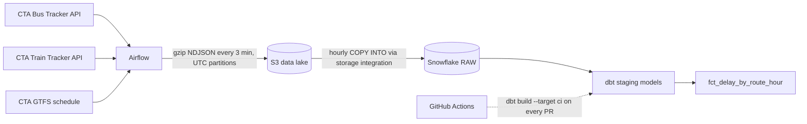

# Chicago Transit Reliability Pipeline


An end-to-end data pipeline that measures how reliably Chicago's buses and 'L' trains run. Every 3 minutes, Airflow snapshots the live position of every CTA bus and train from the Bus Tracker and Train Tracker APIs and lands it as gzipped JSON in an S3 data lake. Each hour, Snowflake loads the new files idempotently. dbt then parses, deduplicates, and tests the data and builds an hourly on-time-performance mart by route. Infrastructure is defined in Terraform, and GitHub Actions runs the dbt build and tests on every pull request.



**Stack:** Python, Apache Airflow 3 (Astro CLI + Docker), AWS S3 and IAM, Terraform, Snowflake, dbt (dbt_utils), GitHub Actions.

## Results

> Placeholder: add headline numbers here (e.g. system-wide on-time ratio, worst routes and hours, bus vs train). Charts below are from the first evening of collection; regenerate them as data accumulates.

**One hour of the network.** Every grey dot is a bus position report; 'L' trains are in their official line colors; circled points were flagged delayed by CTA.


**On-time share by hour of day** (v1 definition: share of pings CTA did not flag as delayed).


**Least on-time routes** (routes with at least 100 pings).


To refresh the CSVs in [`results/`](results/) and the charts (also keeps the numbers after the Snowflake trial ends):

```bash
python scripts/export_mart.py    # mart, recent positions, and summary -> results/*.csv
python scripts/make_charts.py    # results/charts/*.png
```

## Repository layout

```
├── airflow/              # Astro CLI project
│   ├── dags/             # cta_ingest, cta_freshness, cta_load_snowflake, cta_gtfs (+ sql/ templates)
│   ├── include/          # cta_client.py, s3_writer.py, alerts.py, keys/ (gitignored)
│   └── tests/            # DAG integrity + unit tests (astro dev pytest)
├── dbt/                  # dbt project cta_transit (staging -> marts, 38 tests)
├── snowflake/setup.sql   # warehouse, roles, service user, storage integration, stage, raw tables
├── terraform/            # S3 bucket, Airflow IAM user, Snowflake IAM role
├── scripts/              # try_api.py (smoke test), export_mart.py (CSV export), make_charts.py
├── results/              # exported CSVs and charts/
└── .github/workflows/    # dbt CI
```

## Setup

Prerequisites: Python 3.11, Docker, `brew install hashicorp/tap/terraform awscli astro`, an AWS account, a Snowflake trial (AWS US East (Ohio), to match the bucket region), and CTA API keys.

```bash
python3.11 -m venv .venv && source .venv/bin/activate
pip install -r requirements-dev.txt -r dbt/requirements.txt
cp .env.example .env                     # fill in values as you go
```

### 1. CTA API client

Get a [Bus Tracker key](https://www.transitchicago.com/developers/bustracker/) (create a Bus Tracker account, then My Account, then Developer API) and a [Train Tracker key](https://www.transitchicago.com/developers/traintracker/). Put both in `.env`, then:

```bash
python scripts/try_api.py               # prints counts and one sample bus and train
```

### 2. AWS infrastructure (Terraform)

```bash
export AWS_PROFILE=<your admin profile>
cd terraform
cp terraform.tfvars.example terraform.tfvars   # set a globally unique, lowercase bucket_name
terraform init && terraform apply
terraform output                                # bucket, role ARN, access key ID
terraform output -raw airflow_secret_access_key
```

This creates the bucket (public access blocked, SSE-S3, raw `vehicles/` files expire after 90 days), an IAM user `cta-airflow` limited to that bucket, and an IAM role `cta-snowflake-s3` for Snowflake. The role's trust policy starts with placeholders and gets its real values in step 4. Terraform state is local and gitignored because it contains the access key.

### 3. Airflow ingestion into S3

```bash
cd airflow
cp .env.example .env                     # API keys, bucket, AWS connection JSON
astro dev start                          # prints the UI URL
astro dev pytest                         # DAG integrity + unit tests
```

Unpause `cta_ingest` and `cta_freshness` in the UI.

| DAG | Schedule | What it does |
| --- | --- | --- |
| `cta_ingest` | every 3 min | Fetches all buses and trains, adds `ingested_at`, writes `vehicles/source=<bus\|train>/date=YYYY-MM-DD/hour=HH/<source>_<ts>.json.gz` |
| `cta_freshness` | every 15 min | Fails, and alerts Slack if `SLACK_WEBHOOK_URL` is set, when a source's newest file is older than 15 minutes |
| `cta_load_snowflake` | hourly at :05 | `COPY INTO` raw tables from the run's UTC hour and the previous hour |
| `cta_gtfs` | weekly | Downloads the GTFS zip, uploads 5 tables (gzipped) to `gtfs/latest/`, truncates and reloads them |

Data is only collected while your machine and Docker are running.

### 4. Snowflake setup and loading

1. Generate the service user's key pair. It's gitignored and never leaves your machine, except as a GitHub secret in step 6.
   ```bash
   cd airflow/include/keys
   openssl genrsa 2048 | openssl pkcs8 -topk8 -inform PEM -out cta_svc_key.p8 -nocrypt
   openssl rsa -in cta_svc_key.p8 -pubout -out cta_svc_key.pub
   grep -v -- "-----" cta_svc_key.pub | tr -d '\n'; echo     # public key body for setup.sql
   ```
2. In a Snowsight worksheet, run sections 1–3 of [`snowflake/setup.sql`](snowflake/setup.sql) as ACCOUNTADMIN with the placeholders replaced. Copy `STORAGE_AWS_IAM_USER_ARN` and `STORAGE_AWS_EXTERNAL_ID` from `DESC INTEGRATION` into `terraform/terraform.tfvars`, then run `terraform apply` again.
3. Run sections 4–7. `LIST` and the smoke-test `COPY` confirm that Snowflake can read the bucket.
4. Add `AIRFLOW_CONN_SNOWFLAKE_DEFAULT` to `airflow/.env`. It needs `"authenticator":"SNOWFLAKE_JWT"`, because recent Snowflake connectors reject a private key without it. Then run `astro dev restart`, unpause `cta_load_snowflake` and `cta_gtfs`, and trigger `cta_gtfs` once.

Backfill a range of hours (safe to repeat; see the design decision on idempotent COPY below):

```bash
astro dev run backfill create --dag-id cta_load_snowflake \
    --from-date 2026-10-27T00:00:00 --to-date 2026-10-28T00:00:00
```

### 5. dbt models and tests

```bash
set -a; source .env; set +a              # SNOWFLAKE_ACCOUNT, SNOWFLAKE_USER, SNOWFLAKE_PRIVATE_KEY_PATH
cd dbt
dbt deps --profiles-dir .
dbt build --profiles-dir .
dbt source freshness --profiles-dir .
```

| Model | Type | Notes |
| --- | --- | --- |
| `stg_bus_positions` | incremental (merge) | Parses Bus Tracker JSON; dedupes repeat polls of the same report |
| `stg_train_positions` | incremental (merge) | Parses Train Tracker JSON; 0,0 coordinates (train not placed) become null |
| `stg_gtfs_routes` / `_stops` / `_trips` / `_stop_times` | views | Typed GTFS; stop times converted to seconds after midnight, including times past 24:00 |
| `fct_delay_by_route_hour` | table | Position pings, active vehicles, delayed pings, and on-time ratio per mode, route, and Chicago-local hour |

Tests (38): `not_null` and `unique` on keys, `unique_combination_of_columns` on composite keys, `accepted_values` on train line and mode, warn-level Chicago bounding-box checks on coordinates, `on_time_ratio` between 0 and 1, `relationships` (trips to routes, stop times to trips), and a singular test that no bus reports from more than an hour in the future. Source freshness warns after 2 hours and errors after 6.

### 6. CI and branch protection

1. Push the repo to GitHub.
2. Under **Settings → Secrets and variables → Actions → New repository secret**, add:
   - `SNOWFLAKE_ACCOUNT`, e.g. `ORGNAME-ACCOUNTNAME`
   - `SNOWFLAKE_USER`: `CTA_SVC`
   - `SNOWFLAKE_PRIVATE_KEY`: the full contents of `cta_svc_key.p8`, including the `-----BEGIN/END PRIVATE KEY-----` lines
3. Open any pull request that touches `dbt/`. The **dbt CI / dbt-build** check runs `dbt build --target ci` into the `CI` schema.
4. To require the check before merging, go to **Settings → Rules → Rulesets → New branch ruleset**. Set the target to the default branch, enable **Require a pull request before merging** and **Require status checks to pass**, add the `dbt-build` check, and set **Enforcement status** to **Active**. Classic **Settings → Branches → Add branch protection rule** with "Require status checks to pass before merging" works too.

The workflow runs on every PR, but the dbt job only runs when `dbt/` changes. A skipped job counts as passing, so PRs that don't touch dbt aren't stuck waiting on a required check that never reports.

## Design decisions

- **UTC partitions.** S3 paths use `date=/hour=` in UTC. Chicago local time repeats an hour every November and skips one every March, which would create duplicate or missing partitions. UTC partitions also map cleanly to the hourly COPY windows. Vehicle timestamps stay in Chicago local time in dbt, because riders experience schedules in local time.
- **Always write a file.** `cta_ingest` writes a snapshot even when no vehicles are running (overnight), so `cta_freshness` measures whether the pipeline is healthy, not whether buses happen to be out.
- **Idempotent COPY.** Snowflake records which files each table has loaded (for 64 days) and skips them on later `COPY` runs. Each hourly run loads its hour plus the previous one, so a late file gets picked up next hour. Retries and backfills never duplicate rows, which makes "re-run it" the answer to most load failures.
- **Raw JSON as VARIANT.** Raw tables store each API record untouched, and all parsing happens in dbt. A parsing bug is a code fix and a rebuild, never a re-ingest.
- **GTFS columns are strings.** GTFS times like `25:30:00` (trips that run past midnight) aren't valid `TIME` values, and type inference could mangle IDs. Everything lands as `STRING`, and dbt casts deliberately, converting times to seconds after midnight.
- **Key-pair authentication.** Snowflake is phasing out password-only logins. `CTA_SVC` is a `TYPE = SERVICE` user that can't use a password at all. Airflow and dbt sign in with a private key file locally, and CI uses the key from a GitHub secret.
- **UTC `loaded_at`.** Raw tables default `loaded_at` to `SYSDATE()` (UTC). `CURRENT_TIMESTAMP()` would store Pacific time in a `TIMESTAMP_NTZ` column, and dbt source freshness would then think the data was always 7 hours stale.
- **Incremental staging.** Position models merge only rows loaded since the last run, with a 1-hour overlap that the unique-key merge absorbs. The `ci` target reads only the last 2 days, so CI stays fast as raw tables grow.

### On-time definition: v1 vs v2

- **v1 (current):** a ping is delayed if CTA flags it (bus `dly`, train `isDly`), and `on_time_ratio = 1 - delayed_pings / position_pings`. It's simple, consistent across modes, and directly reflects CTA's own system, but it's CTA's definition of "delayed".
- **v2 (planned):** compute lateness independently by comparing actual positions against GTFS scheduled stop times. Open issue: in a sample of 365 live buses, neither the API's `tatripid` nor `origtatripno` matched GTFS `schd_trip_id`, so the trip match will likely need route, block, and scheduled start time instead.

## Cost notes

- **Snowflake:** an XS warehouse (1 credit/hour) with `AUTO_SUSPEND = 60` and `INITIALLY_SUSPENDED`. Hourly loads and dbt runs take seconds, so the warehouse is awake about a minute per hour. The 30-day trial's free credits cover this comfortably. Export results with `scripts/export_mart.py` before the trial ends.
- **AWS:** S3 storage is a few MB per day (about 62 KB per bus snapshot and 3.5 KB per train snapshot, 480 of each per day). PUT requests (about 960 per day) and storage stay within or close to the free tier. A lifecycle rule deletes raw vehicle files after 90 days.
- **CTA API budget:** the Bus Tracker allows 100,000 calls per day. With 125 routes batched 10 per call, each poll makes 13 vehicle calls plus 1 route-list call, so 480 polls per day come to about 6,700 calls. The Train Tracker makes one call per poll for all 8 lines (480 per day).
